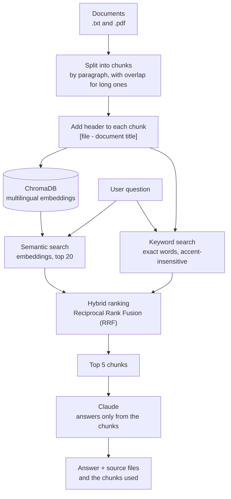

# DocuBot

An assistant that answers questions from a business's own documents and cites the source file for every answer.

DocuBot is a small retrieval-augmented generation (RAG) project. It indexes `.txt` and `.pdf` files, finds the passages most relevant to a question, and asks Claude to answer using only those passages. If the answer is not in the documents, it says so instead of guessing.

The sample documents are for a fictional coffee shop ("Café La Esquina"), and the interface and documents are in Spanish. The retrieval model is multilingual, so the same approach works for other languages.

## How it works



1. **Indexing.** Each file is split into chunks (one per paragraph; long paragraphs are split by lines with a one-line overlap). A document's title is merged into the chunk that follows it, and every chunk gets a `[file — title]` header so it keeps its context.
2. **Hybrid search.** Two rankings are computed for each question: one by meaning (embeddings) and one by exact keywords. Embeddings alone missed a question like "How much is a latte?" because the menu is a list where "latte" is one item among five. Keywords alone miss paraphrases. The two rankings are merged with Reciprocal Rank Fusion (each ranking gives a chunk `1 / (60 + rank)` points), and the top 5 chunks are kept.
3. **Answering.** The 5 chunks are sent to Claude with an instruction to answer only from them. The UI shows the answer plus the file and text of each chunk used, so a reader can check the answer against its source.

## Features

- **Source citations.** Every answer lists the files and chunks it was based on.
- **Document upload.** Upload `.txt` or `.pdf` files in the web UI; they are indexed immediately, without restarting. Unreadable files (a scanned PDF with no text, a non-UTF-8 `.txt`) are rejected with a message.
- **Hybrid search.** Semantic search plus exact-keyword search, merged with RRF.
- **Usage and size limits.** Questions are limited to 500 characters, uploads to 2 MB, and there is a daily question cap (`LIMITE_PREGUNTAS_DIA`, default 50) to protect API credit.
- **Grounded answers.** Claude is instructed to use only the retrieved text and to say "I don't have that information" when the documents do not cover the question.

## Tech stack

- Python 3.12
- [Claude API](https://docs.anthropic.com/) (`claude-sonnet-5-5`) for answer generation
- [ChromaDB](https://www.trychroma.com/) as the vector store
- [sentence-transformers](https://www.sbert.net/) with `paraphrase-multilingual-MiniLM-L12-v2` for local, free, multilingual embeddings
- [Gradio](https://www.gradio.app/) for the web interface
- `pypdf` for reading PDFs

## How to run locally

These steps are for Windows (PowerShell). You need Python 3.12 and an [Anthropic API key](https://console.anthropic.com/).

```powershell
git clone https://github.com/kalebtf/docubot.git
cd docubot

python -m venv .venv
.venv\Scripts\activate
python -m pip install -r requirements.txt
```

Create a file named `.env` in the project folder with your key:

```
ANTHROPIC_API_KEY=your-api-key-here
```

`.env` is listed in `.gitignore`, so it is not committed. Then start the app:

```powershell
python app.py
```

Open the address printed in the terminal (normally http://127.0.0.1:7860; if that port is busy, Gradio uses the next one).

Notes:

- The first run downloads the embedding model (about 460 MB) into the Hugging Face cache. Later runs reuse it.
- The index is rebuilt from the `documentos/` folder every time the app starts.
- Each question calls the Claude API and costs a small amount of credit.

## Evaluation

I wrote a set of 16 questions (`preguntas_evaluacion.json`) and a script (`evaluacion.py`) that checks two things for each one:

- **Answer:** does the response contain the facts it should (price, hours, policy), allowing alternative wordings? For questions whose answer is not in the documents, does it say so?
- **Retrieval:** is the chunk that holds the answer inside the top 5 results? This is measured separately from the answer, so a failure can be traced to search or to generation.

| Version | Answers correct | Retrieval correct |
| --- | --- | --- |
| Before the fix | 15 / 16 | 15 / 16 |
| After the fix | 16 / 16 | 16 / 16 |

**This is not a general accuracy measurement.** It is 16 questions written by the author, about 4 short documents the author also wrote, so the results say little about how DocuBot would perform on real, larger, or messier documents. It is useful as a regression check: after each change to the search, I can see whether anything got worse.

### Case study: the catering question

The first version of the evaluation had 10 questions and 9 passed. The failure was "Do you do catering for events?".

- **Symptom.** Claude listed the breakfast package, venue rental, and deposit, but missed the office coffee package ($380).
- **Diagnosis.** That chunk was ranked 8th, outside the top 5, so Claude never saw it. By meaning it ranked 7th. By keyword it scored zero, because it says "café" and "termo" and never uses "catering" or "events". Three other chunks scored in both rankings or matched a keyword, and pushed it down.
- **Fix.** The keyword search now also counts the `[file — title]` header, so "catering" matches every chunk of the events document. Words that appear in the header of every chunk (the business name) are ignored, because otherwise "café" would match all 15 chunks.
- **Result.** The office coffee package moved from 8th to 4th place. Before changing anything I added 6 new questions as a control (americano price, Sundays, reserving a table, loyalty card, parking, a branch in another city). They already passed, so they do not show improvement, but they confirm the fix did not break them. Final result: 16/16 on answers and on retrieval, and no question got worse. Only the ranking order of the catering questions and one promotion question changed.

With 16/16 this test is now at its ceiling and can no longer tell improvements apart. A harder test set is the next step.

## Limitations and next steps

Limitations:

- The documents are fictional and small (4 files, 15 chunks).
- No authentication. In a shared deployment, documents uploaded by one visitor would be visible to all others (there is a single shared collection).
- Not production-ready. It is a portfolio project: no persistent per-user storage, minimal error handling, and the usage counter lives in memory and resets on restart.
- Each question is independent; the chat history is not used.
- The keyword search reads every chunk on each question and does no stemming ("latte" does not match "lattes"). That is fine for a few documents; with thousands it would need a proper index such as BM25.
- A public demo is paused. Free hosting tiers did not fit this app, and I decided to wait until there is a real use case to pay for hosting.

Next steps:

- Add a reranking step (for example, asking Claude to reorder the retrieved chunks) and measure whether it helps.
- Test with more and longer documents, including messy PDFs.
- Build a harder evaluation set, with questions that need information from several files, ambiguous wording, and near-miss questions whose answer is absent.

## Project layout

| File | Purpose |
| --- | --- |
| `app.py` | Gradio web interface, upload handling, usage limits |
| `docubot.py` | Indexing, hybrid search, and answer generation |
| `evaluacion.py`, `preguntas_evaluacion.json` | The 16-question evaluation |
| `documentos/` | Sample documents (fictional coffee shop) |
| `requirements.txt` | Pinned dependencies |
